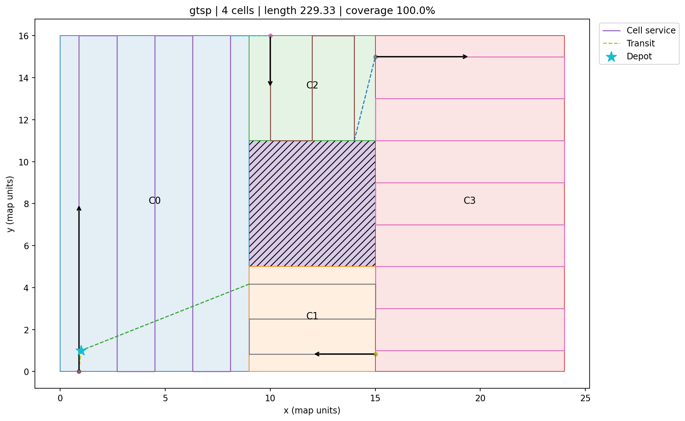

# Boustrophedon Coverage Planning: TSP and Direction-Aware GTSP

A runnable Python starter for an **Advanced Algorithms** project. The pipeline
partitions a polygon with holes, constructs directed zig-zag sweep states, and
compares fixed-state TSP heuristics with a generalized TSP state/order heuristic.

This is an educational implementation, not vehicle-control or safety-certified
software. It uses a point-robot, planar model. Read [the limitations](docs/ALGORITHMS.md#limitations)
before interpreting a path as a physically executable robot or UAV trajectory.

## Implemented

| Component | Implementation |
|---|---|
| Boustrophedon decomposition | Incremental floor/ceiling sweep, split/merge handling, adjacency graph |
| Sweep patterns | Four start/order permutations per valid angle; initial left/right turn metadata |
| TSP baseline | One fixed sweep state per cell, nearest-neighbor, directed-safe 2-opt |
| GTSP heuristic | One state per cell, exact state-selection DP for a fixed order, 2-opt order search, seeded restarts |
| Tiny-instance oracle | Subset DP for the discretized GTSP, limited to 8 cells |
| Transitions | Obstacle-aware Euclidean shortest paths on a visibility graph |
| Evaluation | Coverage, path length, transit length, lane reversals, angular turning, overlap, runtime |
| Tooling | CLI, benchmark command, tests, GitHub Actions, JSON/GeoJSON/PNG exports |



## Quick start

Python 3.11 or later. Run these commands from this directory.

```sh
python -m venv .venv
```

Activate the environment:

```powershell
# Windows PowerShell
.\.venv\Scripts\Activate.ps1
```

```sh
# macOS / Linux
source .venv/bin/activate
```

Then install and test:

```sh
python -m pip install --upgrade pip
python -m pip install -e ".[dev]"
python -m pytest
```

Compare the planners:

```sh
coverage-plan examples/one_obstacle.json --algorithm tsp-greedy --out results/greedy
coverage-plan examples/one_obstacle.json --algorithm tsp-2opt --out results/tsp
coverage-plan examples/one_obstacle.json --algorithm gtsp --out results/gtsp
coverage-plan examples/one_obstacle.json --algorithm gtsp-exact --out results/exact
```

Each run writes `plan.json`, `metrics.json`, `geometry.geojson`, and `trajectory.png`.
The GeoJSON uses **local planar coordinates**, not longitude/latitude.

A module invocation is also available when the console command is not on PATH:

```sh
python -m coverage_planning.cli examples/one_obstacle.json --algorithm gtsp
```

## Initial turn direction is an explicit state variable

A state is an entire directed path, not a centroid:

```text
(cell, lane angle, lane order, first pass direction, first turn, entry, exit, path)
```

For vertical lanes, there are four possibilities:

| Lane progression | First pass | Nominal first U-turn |
|---|---|---|
| Left to right | Up | Right |
| Left to right | Down | Left |
| Right to left | Up | Left |
| Right to left | Down | Right |

`--first-turn any` lets GTSP choose either side independently in each cell.
`--first-turn left` or `right` filters candidates in **every multi-lane cell**.
It is not a constraint on only the first maneuver of the global mission.
Single-lane cells have `first_turn="none"` and are permitted under either filter.
The side describes the nominal lane reversal, not the first corner in an
obstacle-avoiding connector, and does not prescribe a feasible curved maneuver.

```sh
coverage-plan examples/one_obstacle.json --algorithm gtsp --angles 90 0 --first-turn any
coverage-plan examples/one_obstacle.json --algorithm gtsp --first-turn left --out results/left
coverage-plan examples/one_obstacle.json --algorithm gtsp --first-turn right --out results/right
```

Actual initial vehicle heading is separate:

```sh
coverage-plan examples/one_obstacle.json --algorithm gtsp --start-heading 90 --turn-weight 0.5
```

The heading is measured counterclockwise from +X and changes the angular penalty.
It is not a nonholonomic heading constraint. With zero `--turn-weight`, the
heading does not affect the objective.

## Geometry and angle conventions

`--decomposition-angle 90` uses vertical slices, advanced along X, and produces
X-monotone cells. Angle `0` uses horizontal slices, advanced along Y, and produces
Y-monotone cells. Candidate sweep angles are checked for monotonicity separately
for every cell; invalid alternatives are skipped, not forced through obstacles.

```sh
coverage-plan examples/concave_u.json --decomposition-angle 0 --angles 0 90
```

The default candidate angles are the decomposition angle followed by 0 degrees,
with duplicates removed. Request additional orientations explicitly.

## Coverage and boundary handling

The swath is the width of the sensor/tool footprint, **not** the robot diameter.
Lane spacing defaults to the swath and may be reduced, but not increased above it.
Finite lane sampling can leave gaps near slanted/acute boundaries. Coverage is
measured by clipped buffered service segments; it is never assumed to be 100%.

```sh
coverage-plan examples/two_obstacles.json --spacing 1.5 --swath 2 --boundary-pass
```

`--boundary-pass` adds a complete perimeter pass to every cell. This helps close
boundary gaps in the point-robot model but adds length and can traverse artificial
cell boundaries. It is not a complete coverage proof for a finite-sized vehicle.
Sensors are considered off during inter-cell transit for coverage metrics.

Routes return to the depot by default. Use `--open` for a fixed-start, free-end route.

## Map format

```json
{
  "name": "One obstacle",
  "units": "metres",
  "boundary": [[0, 0], [24, 0], [24, 16], [0, 16]],
  "holes": [[[9, 5], [15, 5], [15, 11], [9, 11]]],
  "start": [1, 1],
  "swath": 2.0
}
```

Use one valid connected polygon with valid holes and planar coordinates. Avoid
zero-width passages, self-intersections, and scales near floating-point precision.
A missing start is replaced with a representative interior point. An invalid
start inside a hole or outside the boundary is rejected.

## Benchmarks

```sh
coverage-benchmark --maps examples --seeds 0 1 2 --out results/benchmark.csv
coverage-benchmark --maps examples --seeds 0 1 2 --boundary-pass --out results/with_boundary.csv
```

All algorithms use the same decomposition, state candidates, swath, depot, and
cost rules. TSP fixes the first generated state per cell. GTSP searches the full
candidate set. The first GTSP seed uses the TSP order; consequently its objective
cannot be worse than this baseline for the same model. This is **not** a global
optimality guarantee. Compare the tiny-instance exact oracle for additional evidence.

Every benchmark run builds a fresh model, avoiding warmed caches from a previous
solver. Planning time excludes output rendering and metric computation.

## Repository map

```text
src/coverage_planning/
  geometry.py          Geometry validation, rotation, monotonicity
  decomposition.py     Incremental BCD and cell adjacency
  sweeps.py            Directed sweep candidates and turn-side filters
  transitions.py       Visibility graph and Dijkstra
  costs.py             Directed service/transition costs
  planners/
    tsp.py             Nearest-neighbor and 2-opt
    gtsp.py            State DP and local order search
    exact.py           Small-instance subset DP oracle
  metrics.py           Coverage and motion metrics
  pipeline.py          End-to-end API and exports
  cli.py               Single-map command
  benchmark.py         Reproducible comparisons
  visualization.py     Headless trajectory plots
examples/              Four small input maps
tests/                 Geometry, state, solver, integration, and CLI checks
docs/                  Algorithm notes, roadmap, references, validation
.github/               CI and contribution templates
```

## Publish to GitHub

The ZIP is a source directory, not an authenticated GitHub repository.
Do not upload the ZIP as a single repository file; extract and commit its contents.
With Git and GitHub CLI installed:

```sh
git init -b main
git add .
git commit -m "Initialize BCD, TSP, and direction-aware GTSP project"
gh auth login
gh repo create boustrophedon-coverage-planning --private --source=. --remote=origin --push
```

If Git requests identity, configure your own `user.name` and `user.email` locally.
The command defaults to a private repository for coursework; choose public only
when appropriate for your course and collaboration arrangements.

Without GitHub CLI, create an empty repository on GitHub (no generated README), then:

```sh
git remote add origin https://github.com/YOUR_USERNAME/boustrophedon-coverage-planning.git
git push -u origin main
```

Do not put access tokens into source files. The CI workflow is included but only
runs on GitHub after publishing. See [GitHub setup notes](docs/GITHUB_SETUP.md).

## Reading and next steps

- [Algorithm formulation, invariants, complexity, and limitations](docs/ALGORITHMS.md)
- [Milestones for the course project](docs/ROADMAP.md)
- [Primary references and implementation provenance](docs/REFERENCES.md)
- [Local validation record](docs/VALIDATION.md)

The code is newly written for this starter. It is not copied from the ETH Zurich
implementation and does not claim to reproduce its solver or benchmark results.
No paper PDFs are redistributed. An MIT license is supplied for this starter;
review the license choice before publishing third-party additions.
